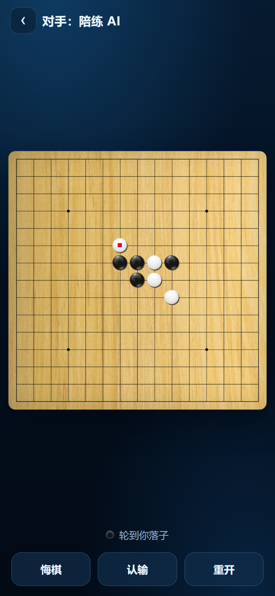

# 五子棋冒险（Gomoku Quest）· 网页版

> 把 Mindwalk 的 Flutter 应用《Gomoku Quest》搬到浏览器 / iPhone 上的实现。
>
> 规则引擎、AI、VCF 求解器、界面均**重新编写**；棋盘、棋子、音效、logo、题库与课程文案取自原版安装包，
> **仅用于个人学习与备份**，版权归原作者 **Mindwalk** 所有，请勿用于商业用途。若原作者提出要求，会立即移除相关素材。

连珠对弈 + **4200 道 VCF 挑战题** + 7 节连珠课程，支持中 / 英 / 日 / 韩四语言，纯前端、无需联网。

**在线使用**：开启 GitHub Pages 后，用 iPhone Safari 访问 → 分享 → 添加到主屏幕，即是全屏离线 App。



---

## 功能

- **对局**：15×15 连珠，完整禁手（三三 / 四四 / 长连）、开局限制、三档 AI、悔棋 / 认输 / 重开
- **VCF 挑战**：14 套题库 × 300 题（共 4200 题），任意合法点可下，做成四对手被迫堵，附带必胜提示
- **连珠课程**：7 节课，课文内嵌可翻步的交互棋盘
- **设置**：四语言即时切换、4 种棋盘、3 种棋子、BGM / 音效开关

> 详细安装步骤、导入题库格式、常见问题见 [使用说明.md](使用说明.md)。

---

## 目录

- `web/` —— 网页版（GitHub Pages 指向仓库根目录后访问 `/web/`）
- `单文件版/` —— 一体化 HTML（2.4 MB，含全部题目与图片，不含 BGM）
- `ios/GomokuQuest/` —— 原生 iOS 工程（Xcode，需 Mac 编译）
- `数据/` —— 从原版安装包提取的题库（`problem_sets`）、课程（`lectures`）与翻译
- `tests/` —— VCF 求解器、挑战模式判定、全库普查脚本
- `tools/` —— 构建、图标、本地服务器脚本
- `预览截图/` —— 界面截图

---

## 快速开始（本地）

```bash
node tools/serve.js          # 浏览器打开 http://localhost:8000/
```

在手机上试玩：双击 `启动手机测试.cmd`（Windows），iPhone 连同一个 Wi-Fi 后用 Safari 打开窗口里显示的地址。

---

## 测试

```bash
node tests/vcfgame.test.js   # 挑战模式判定 + 真实题完整回放（11 项）
node tests/vcf.test.js 10    # VCF 求解器（真实题库抽样）
node tests/sweep.js 0        # 全库普查：4200 题各自能否 VCF 解出
node tests/replay.js bg7 161 # 回放某一题，看判定过程
```

全库普查结果：**3847 / 4200（92%）** 题可直接用连续冲四解出；其余 353 题的清单见
[`tests/sweep-result.txt`](tests/sweep-result.txt)（这些题现在也能正常下，只是提示按钮可能算不出必杀）。

---

## 题库编码说明

`数据/problem_sets/*.txt` 每行一题，值以 `;` 分隔：

- 坐标：`x = v & 31`, `y = v >> 5`（棋盘 15×15）
- 颜色：按出现顺序**黑白交替**（第一个为黑）

---

## 性能与体积

首屏只加载必需的部分，题库、课程、背景音乐都改成按需加载（国内网络下尤其明显）：

| 项目 | 体积 | 加载时机 |
| --- | --- | --- |
| HTML + CSS + 首屏脚本 | 约 123 KB | 首屏 |
| 背景图 / logo / 图标 | 约 196 KB | 首屏 |
| problems.js（4200 题） | 208 KB | 进入「VCF 挑战」时 |
| lectures.js（7 节课） | 42 KB | 打开课程时 |
| game_bgm.mp3 | 2.6 MB | 开局后 1.5 秒（且需开启音乐） |

首屏合计约 **320 KB**（改造前约 600 KB+）。

在 iOS Safari 里直接打开时会自动弹出「添加到主屏幕」提示条，装到桌面后全屏、离线可用。

## 已知限制

- AI 与 VCF 求解器均为本地 JavaScript 实现，棋力约相当于中级爱好者。
- 原版的在线对战、排行榜、商店、广告依赖 Mindwalk 服务器，未包含。
- 进度保存在浏览器 localStorage，清理网站数据会丢失。

---

## 素材来源与声明

- 原版：《Gomoku Quest》，开发发行方 **Mindwalk**（Flutter / Android）。
- 本仓库中的棋盘贴图、棋子图、logo、音效、课程文案、题库与界面素材均从原版 APK 提取，
  仅作个人学习与备份使用，**版权归 Mindwalk 所有**，本仓库不对其主张任何权利。
- 其余代码（`web/js/engine.js`、`vcf.js`、`ui.js`、`tools/`、`tests/` 等）为本项目编写。
- 如原作者不希望素材被转载，请提 Issue，会立即删除。


